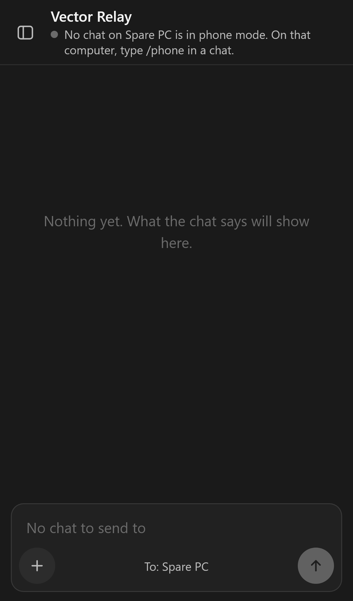

# Vector Relay

See the AI chats on your PC from your phone, and send them the next prompt. From anywhere: the
phone needs the internet, not your Wi-Fi.

## What it does

- A chat posts **updates**, **results** and **pictures** to your phone while it works.
- You type the **next prompt** on the phone, with a **photo** if you like. The chat on the PC
  picks it up and carries it out.
- **Several chats at once.** Each chat in phone mode is a chip at the top of the page. Tap one to
  read it and to send to it; a chip gets an orange mark when its chat said something new.
- A chat can **wait for you all day**. Waiting costs the chat nothing.
- The phone says in plain words what is going on: *Vector is working*, *Vector is waiting for
  your prompt*, *Your PC does not answer*.
- It is a web page, kept on the iPhone Home Screen like an app. Nothing to install from a store.

| A picture from the chat | Two chats, and a photo from the phone | Dark |
|---|---|---|
|  |  |  |

## How it works

    phone  --prompt-->  relay  --prompt-->  helper on the PC  -->  the chat it is for
    phone  <--feed----  relay  <--feed----  helper on the PC  <--  what the chats post

Vector Relay does not hook into the chat app. A chat's own agent runs three commands with the
tools it already has:

| Command | What it does |
|---|---|
| `vector_relay.py on --label "Atlas FA"` | Phone mode on for this chat. Prints the chat's id and starts the small background helper. |
| `vector_relay.py say --chat <id> "reading the leak data"` | Posts an update. `--kind result --file result.md` posts a result, `--image plot.png` a picture. |
| `vector_relay.py listen --chat <id>` | Waits for the next prompt from the phone and prints it. A photo arrives as `IMAGE <path of the file>`. |

The skill in `skill/phone-relay/SKILL.md` teaches a chat this loop: type `/phone` in the chat.

Other commands: `pair`, `off`, `status`, `stop`, `forget`.

The page and the relay live at one address, [vector-relay.pages.dev](https://vector-relay.pages.dev):
a Cloudflare Pages project with one Pages Function (`functions/`) and one D1 database
(`schema.sql`). It shares nothing with any other app.

## Set it up (once)

1. Python 3.10 or newer, then `pip install cryptography segno pillow`.
   A chat app may run commands with a Python of its own that lacks these. Vector Relay then
   hands the command to the Python on the PC that has them, by itself.
2. `python vector_relay.py pair --open`
   A QR code opens on the PC. Scan it with the phone's camera.
3. On the iPhone: Share, then **Add to Home Screen**.
4. In a chat on the PC, type `/phone` (with the skill installed), and leave.

### A second computer, or no camera at hand: 4 digits instead of the QR code

1. On that computer, Windows or Mac. Nothing to deploy, nothing to copy from the first computer:

       git clone https://github.com/juw12/vector-relay
       python -m pip install cryptography segno pillow        (on a Mac: python3 -m pip ...)

   Copy `skill/phone-relay/SKILL.md` into the chat app's skills folder and change its two lines
   that hold the path of `vector_relay.py` to where the clone is on that computer.
2. There, type `/phone code` in a chat (or run `python vector_relay.py pair --code`). It prints
   `Code for the phone: 1234` and one line that says where to type it. Nothing else.
3. On the phone: **Device**, **+ Add device**, a name for that computer, the 4 digits.
4. The phone switches to the new computer and names it: *No chat on MacBook is in phone mode. On
   that computer, type /phone in a chat.* Do that, and the chat shows up.

A code links one phone, works for 5 minutes and dies after 3 wrong answers. `pair --no-code`
takes it back before that. Two computers can be added one right after the other: the second
waits up to 20 seconds for its turn. One phone page then holds every computer you added, each
with its own key. Choose the computer under **Device** first, then the chat; the line above the
prompt box always says where a prompt goes (*To: MacBook*), and it goes to that computer only.

| The 4 digits on the phone | Right after the computer is added |
|---|---|
|  |  |

To run your own relay instead of the public one: the four commands at the top of `wrangler.toml`,
then `pair --relay https://<your-project>.pages.dev`. A relay sees ciphertext only, so sharing one
is safe; your own gives you your own free quota.

## What it cannot do

- **A chat must be put in phone mode at the PC first.** The phone cannot start a new chat, and it
  cannot wake a chat that is not in phone mode. Vector Relay does not reach into the chat app, so
  this stays. Type `/phone` before you leave; the chat then waits as long as you like.
- **The PC must stay on and awake**, with the chat app open.
- **The phone does not ring.** With the page closed, nothing announces a new result: open the
  page to look. A chip's orange mark shows which chat said something since you last read it.
- **A picture is made smaller for the trip**: 1600 px on its longest side, both ways. Other files
  (Excel, PDF) do not travel; the chat gives the path on the PC instead.
- A prompt reaches the PC only when the phone shows it as *picked up*. One marked *not sent*
  is never carried out later by itself; tap **Try again**.

## Is it safe

- Everything that leaves the PC or the phone is sealed with AES-256-GCM, pictures included. The
  key is made on the PC and reaches the phone only inside the QR code, after the `#` of the
  address, which a browser sends to no server.
- The relay stores sealed text it cannot read. At worst it can lose or delay it.
- A 4-digit code never travels. PC and phone each prove they know it (SPEKE, RFC 3526 group
  14), and the link with the key then comes sealed with a key the two made in that exchange.
  Nobody can try the 10,000 codes at home: each guess has to reach the PC, which takes three
  and then drops the code. That leaves a stranger who knows your relay's address and guesses
  during your 5 minutes 3 chances in 10,000. Make a code only when you are about to type it.
- Whoever holds the key can prompt your chats. Do not share the QR picture, the link, or the Home
  Screen icon's address. Lost the phone: `vector_relay.py forget`, then pair again.
- A prompt is carried out once. Its id is remembered, and one older than 15 seconds (45 with a
  photo) is refused, so a recorded prompt cannot be played again.
- A prompt goes to one chat, the one you chose. A chat that left phone mode gets nothing.
- The phone page shows results as text. HTML inside a result stays text.
- Your prompts and results do pass through the relay (sealed). Whether that is allowed for your
  work data is your call.

## Relay budget

Cloudflare's free plan gives an account 100,000 requests a day. The relay holds the helper's
request open until the phone asks something, so a chat that waits all day with the phone closed
costs about 180 requests an hour (4,300 a day). With the page open on the phone it is about
2,000 an hour, and up to 6,000 while a chat is busy. The helper stops by itself 10 minutes after
the last chat leaves phone mode.

## Tests

    python -m unittest discover -s tests   60 tests: seal, feed, inbox, chats, pictures, commands, whole trips,
                                           local mode, the 4-digit code
    python scripts/e2e.py                  the phone page in WebKit (as an iPhone 14) and Chromium
                                           (as a Pixel 7), relay rules in memory: 66 steps
    python scripts/e2e.py --live           the deployed page and relay, on throwaway channels that
                                           are wiped at the end: 63 steps. The 8 local Wi-Fi steps
                                           are left out (they use no relay), and 5 are added: a
                                           phone with no computer yet adds its first one by code,
                                           and the channel is wiped

`scripts/e2e.py` needs `pip install playwright` and `playwright install webkit chromium`.

Not yet checked: a real iPhone (WebKit on Windows is the closest stand-in), and a Mac as the
second computer on the public relay (the Mac build was checked on a relay of its own).

## Versions

- **1.2.1** `pair --code` prints the code alone, with no QR lines to read past. `pair --no-code`
  takes a code back. A second computer gets its code right after the first one was used (it was
  refused for 15 seconds before). Right after it is added, the phone names the new computer and
  says the next step, where it showed an error until a chat was in phone mode. A computer whose
  chats all left phone mode shows the same calm line instead of *Your PC does not answer*.
- **1.2.0** Add a computer on the phone with a 4-digit code.
- **1.1.0** Several computers on one phone page (the device picker), and a local Wi-Fi mode
  that needs no relay.
- **1.0.0** A relay and an address of its own, several chats at once, pictures both ways,
  waiting all day.

## Files

| Path | What |
|---|---|
| `vector_relay.py` | The PC side, one file. |
| `docs/` | The phone page. |
| `functions/c/[[path]].js`, `schema.sql`, `wrangler.toml` | The relay: a Pages Function and its D1 database. |
| `skill/phone-relay/SKILL.md` | The `/phone` skill for the chat's agent. |
| `tests/`, `scripts/e2e.py` | The checks above. |

MIT License.
