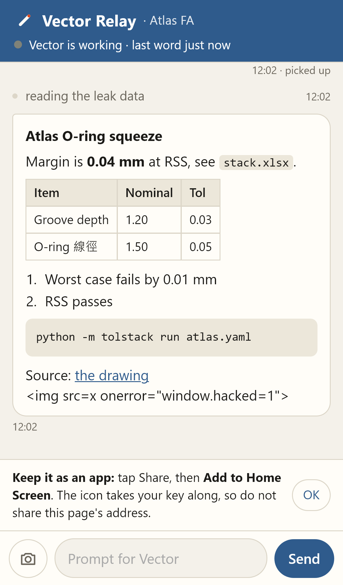
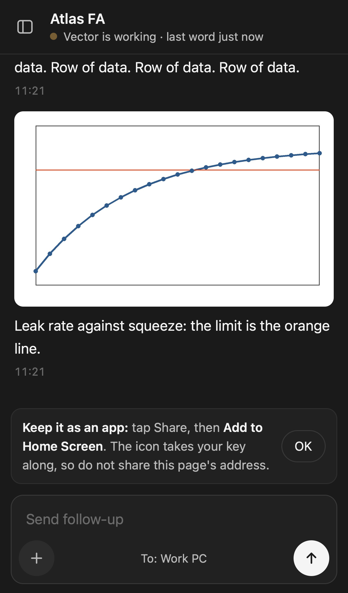
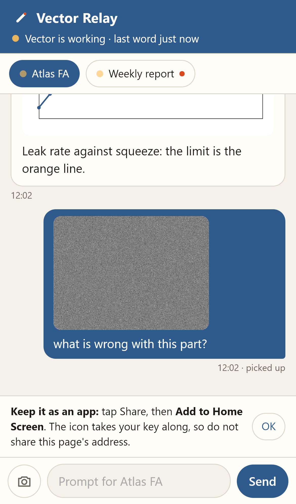
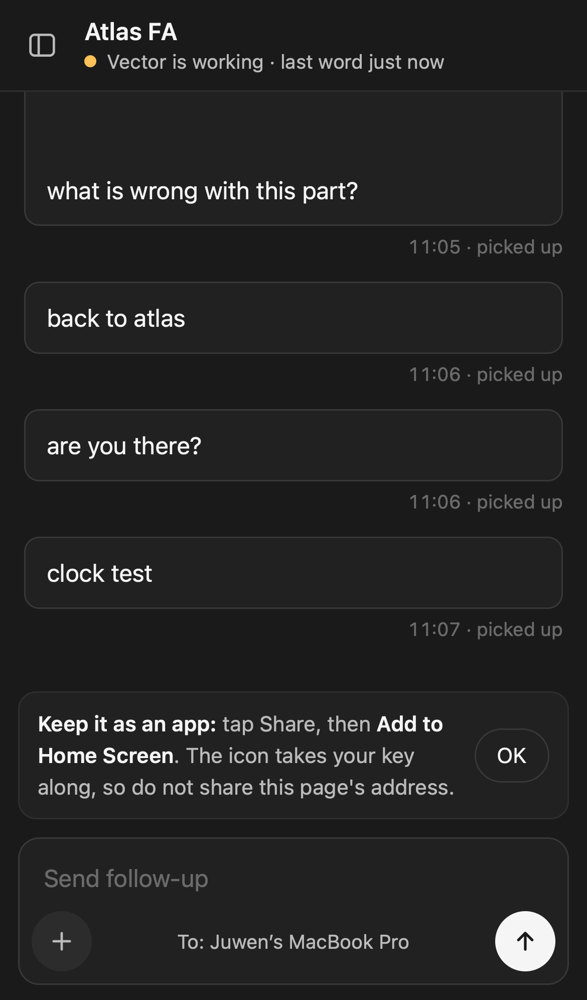
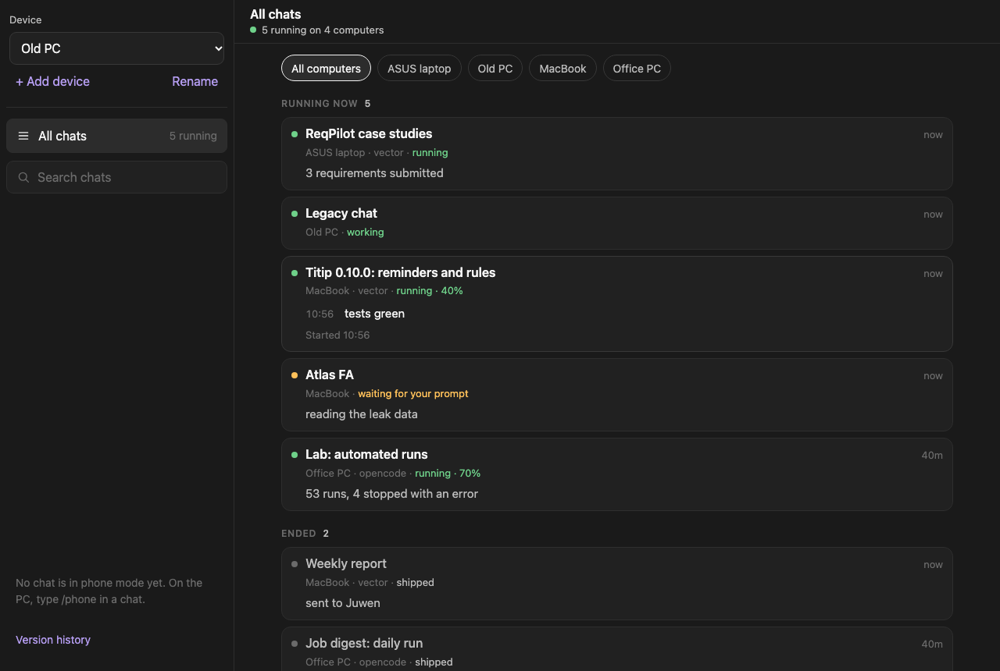
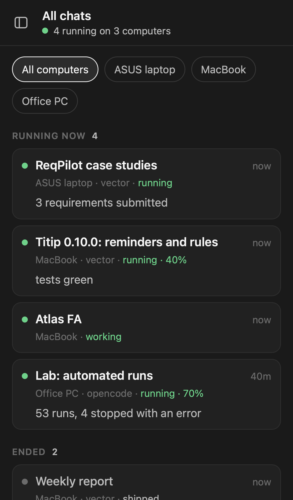
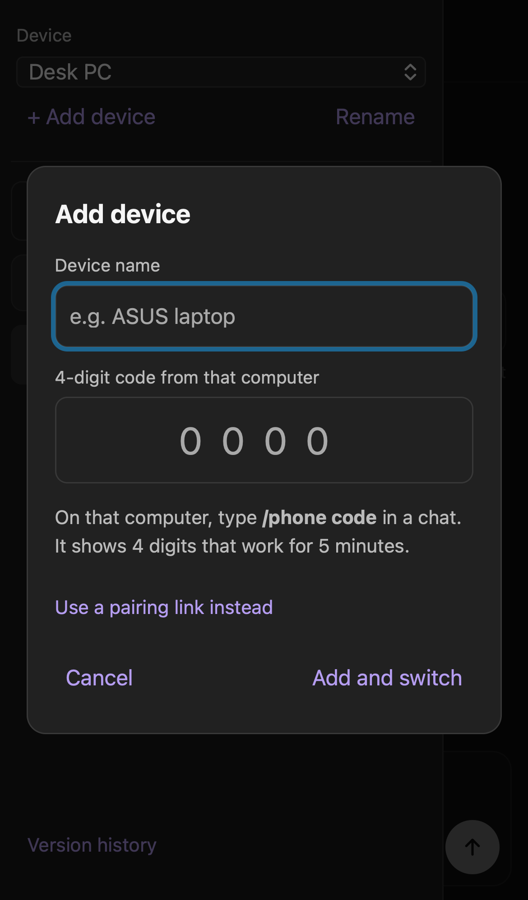

# Vector Relay

See the AI chats on your PC from your phone, and send them the next prompt. From anywhere: the
phone needs the internet, not your Wi-Fi.

## What it does

- A chat posts **updates**, **results** and **pictures** to your phone while it works.
- You type the **next prompt** on the phone, with a **photo** if you like. The chat on the PC
  picks it up and carries it out.
- **Several chats at once.** Each chat in phone mode is a chip at the top of the page. Tap one to
  read it and to send to it; a chip gets an orange mark when its chat said something new.
- A chat can **wait for you all day**. Waiting costs the chat nothing.
- **All chats.** One list of every chat on every computer you added, the running ones first,
  each with its last step. Also for chats that are not in phone mode, and also on the computer
  itself: `vector_relay.py view`. See [All chats](#all-chats-what-every-chat-is-doing).
- The phone says in plain words what is going on: *Vector is working*, *Vector is waiting for
  your prompt*, *Your PC does not answer*.
- It is a web page, kept on the iPhone Home Screen like an app. Nothing to install from a store.

| A picture from the chat | Two chats, and a photo from the phone | Dark |
|---|---|---|
|  |  |  |

## How it works

    phone  --prompt-->  relay  --prompt-->  helper on the PC  -->  the chat it is for
    phone  <--feed----  relay  <--feed----  helper on the PC  <--  what the chats post

Vector Relay does not hook into the chat app. A chat's own agent runs three commands with the
tools it already has:

| Command | What it does |
|---|---|
| `vector_relay.py on --label "Atlas FA"` | Phone mode on for this chat. Prints the chat's id and starts the small background helper. |
| `vector_relay.py say --chat <id> "reading the leak data"` | Posts an update. `--kind result --file result.md` posts a result, `--image plot.png` a picture. |
| `vector_relay.py listen --chat <id>` | Waits for the next prompt from the phone and prints it. A photo arrives as `IMAGE <path of the file>`. |

The skill in `skill/phone-relay/SKILL.md` teaches a chat this loop: type `/phone` in the chat.

Other commands: `pair` links a phone (QR code, or `--code` for 4 digits), `off` takes a chat out of
phone mode, `status` says what is linked and running, `stop` stops the background helper (the next
`on` starts it again), `forget` unlinks every phone and clears the feed. `step`, `board` and `view`
are for [All chats](#all-chats-what-every-chat-is-doing).
`pair --local` uses no relay at all: the PC itself serves the page to a phone on the same Wi-Fi.

The page and the relay live at one address, [vector-relay.pages.dev](https://vector-relay.pages.dev):
a Cloudflare Pages project with one Pages Function (`functions/`) and one D1 database
(`schema.sql`). It shares nothing with any other app.

## All chats: what every chat is doing

The chat list has **All chats** on top. It lists every chat of every computer the page knows:
what it is about, on which computer, whether it runs, how far it is, and its last step. Tap a row
for its last five steps. A chat that is in phone mode has **Open this chat** there, which leads to
its prompt box. With more than one computer, a row of names lets you look at one alone.

| On a wide screen | On the phone |
|---|---|
|  |  |

A chat gets on the list in one of three ways:

| How | What to run |
|---|---|
| It is in phone mode | Nothing. `on` lists it, and each `say` is its step. `off` ends it. |
| It posts its own steps | `vector_relay.py step --title "Atlas FA" "reading the leak data"` prints `ok chat=<id>`. Then `step --chat <id> --progress 40 "tests green"`, and `step --chat <id> --end shipped "report sent"` when it is over (`shipped`, `partial`, `dropped` or `done`). |
| Its computer keeps session notes | `vector_relay.py board --notes <folder> --this "<the name the notes give this computer>"` once. Every note in that folder is a row. `--machine <name>` or `--agent <name>` takes only those; `board --no-notes` stops it. |

A session note is a Markdown file as [Cairn](https://github.com/juw12/cairn) writes them: a head
with `title`, `status` (`live`, `shipped`, `partial`, `dropped`, `done`), `started`
(`2026-11-21T10:01`), `machine` and `agent`, then `## Log` with lines like
`- 10:15 note: [40%] tests green`. A folder that several computers share shows each note under
the computer it names, once, whichever computer published it. With `--this`, the notes that name
this computer are listed under the name it has on the page, with its other chats.

**On the computer itself:** `vector_relay.py view` opens the page in the browser there, already
linked to that computer and on All chats. No phone and no code are needed. The helper hands the
page out on a port only that computer can reach, so it is the version of this repo. To see a second
computer there too: on that one `pair --code`, then on the page **Device**, **+ Add device**, its
4 digits. `vector_relay.py board` prints the list in the terminal.

How fresh it is: the computer whose chats the page shows answers every few seconds. Every other
computer is asked every 20 seconds while All chats is open. One that does not answer (asleep, or
no helper running) shows the copy the relay keeps, which a helper renews at most every 2 minutes,
and the foot of the list says when each computer was last heard.

- A chat is on the list only when one of the three ways above puts it there. Vector Relay does
  not look into the chat app.
- A running chat with no step for 6 hours is shown as *no word since ...* under Ended. A chat
  that ended stays 7 days. The list holds 40 chats: all that run, then the ones that ended last.
- With `board --notes`, or while a chat that posts steps runs, the helper keeps running without
  any chat in phone mode. `step`, `on`, `view` and `board --notes` start it; nothing starts it
  after a restart of the computer until one of them runs.
- A computer with a Vector Relay from before 1.3.0 shows only its chats in phone mode, and the
  foot of the list says so.

## Set it up (once)

1. Python 3.10 or newer, then `pip install cryptography segno pillow`.
   A chat app may run commands with a Python of its own that lacks these. Vector Relay then
   hands the command to the Python on the PC that has them, by itself.
2. `python vector_relay.py pair --open`
   A QR code opens on the PC. Scan it with the phone's camera.
3. On the iPhone: Share, then **Add to Home Screen**.
4. In a chat on the PC, type `/phone` (with the skill installed), and leave.

### A second computer, or no camera at hand: 4 digits instead of the QR code

1. On that computer, Windows or Mac. Nothing to deploy, nothing to copy from the first computer:

       git clone https://github.com/juw12/vector-relay
       python -m pip install cryptography segno pillow        (on a Mac: python3 -m pip ...)

   Copy `skill/phone-relay/SKILL.md` into the chat app's skills folder and change its two lines
   that hold the path of `vector_relay.py` to where the clone is on that computer.
2. There, type `/phone code` in a chat (or run `python vector_relay.py pair --code`). It prints
   `Code for the phone: 1234` and one line that says where to type it. Nothing else.
3. On the phone: **Device**, **+ Add device**, a name for that computer, the 4 digits.
4. The phone switches to the new computer and names it: *No chat on MacBook is in phone mode. On
   that computer, type /phone in a chat.* Do that, and the chat shows up.

What the phone says when a code does not work:

- Wrong digits, tries left: *That is not the code. Check the 4 digits on the computer and try again.*
- Third wrong answer: *That is not the code, and it has stopped working now. Make a new code on the computer.*
- No code is waiting (it ran out, or was taken back): *No computer is showing a code right now. On
  that computer, type /phone code in a chat, then enter its 4 digits here.*
- The computer stopped answering part way: *The computer did not answer. Make a new code on it and
  try again.*

A code links one phone, works for 5 minutes and dies after 3 wrong answers. `pair --no-code`
takes it back before that. Two computers can be added one right after the other: the second
waits up to 20 seconds for its turn. One phone page then holds every computer you added, each
with its own key. Choose the computer under **Device** first, then the chat; the line above the
prompt box always says where a prompt goes (*To: MacBook*), and it goes to that computer only.
**Rename** under **Device** changes the name the phone shows for the chosen computer; nothing
changes on the computer.

| The 4 digits on the phone | Right after the computer is added |
|---|---|
|  |  |

To run your own relay instead of the public one: the four commands at the top of `wrangler.toml`,
then `pair --relay https://<your-project>.pages.dev`. A relay sees ciphertext only, so sharing one
is safe; your own gives you your own free quota.

## What it cannot do

- **A chat must be put in phone mode at the PC first.** The phone cannot start a new chat, and it
  cannot wake a chat that is not in phone mode. Vector Relay does not reach into the chat app, so
  this stays. Type `/phone` before you leave; the chat then waits as long as you like.
- **The PC must stay on and awake**, with the chat app open.
- **The phone does not ring.** With the page closed, nothing announces a new result: open the
  page to look. A chip's orange mark shows which chat said something since you last read it.
- **A picture is made smaller for the trip**: 1600 px on its longest side, both ways. Other files
  (Excel, PDF) do not travel; the chat gives the path on the PC instead.
- A prompt reaches the PC only when the phone shows it as *picked up*. One marked *not sent*
  is never carried out later by itself; tap **Try again**.

## Is it safe

- Everything that leaves the PC or the phone is sealed with AES-256-GCM, pictures included. The
  key is made on the PC and reaches the phone only inside the QR code, after the `#` of the
  address, which a browser sends to no server.
- The relay stores sealed text it cannot read. At worst it can lose or delay it.
- A 4-digit code never travels. PC and phone each prove they know it (SPEKE, RFC 3526 group
  14), and the link with the key then comes sealed with a key the two made in that exchange.
  Nobody can try the 10,000 codes at home: each guess has to reach the PC, which takes three
  and then drops the code. That leaves a stranger who knows your relay's address and guesses
  during your 5 minutes 3 chances in 10,000. Make a code only when you are about to type it.
- Whoever holds the key can prompt your chats. Do not share the QR picture, the link, or the Home
  Screen icon's address. Lost the phone: `vector_relay.py forget`, then pair again.
- A prompt is carried out once. Its id is remembered, and one older than 15 seconds (45 with a
  photo) is refused, so a recorded prompt cannot be played again.
- A prompt goes to one chat, the one you chose. A chat that left phone mode gets nothing.
- The phone page shows results as text. HTML inside a result stays text.
- Your prompts and results do pass through the relay (sealed). Whether that is allowed for your
  work data is your call.

## Relay budget

Cloudflare's free plan gives an account 100,000 requests a day. The relay holds the helper's
request open until the phone asks something, so a chat that waits all day with the phone closed
costs about 180 requests an hour (4,300 a day). With the page open on the phone it is about
2,000 an hour, and up to 6,000 while a chat is busy. The helper stops by itself 10 minutes after
the last chat leaves phone mode, unless it is kept for All chats (`board --notes`, or a chat that
posted a step in the last 6 hours): then it costs the same 180 requests an hour while it runs.

## Tests

    python -m unittest discover -s tests   82 tests: seal, feed, inbox, chats, pictures, the board, commands,
                                           whole trips, local mode, the 4-digit code, the list of versions
    python scripts/e2e.py                  the phone page in WebKit (as an iPhone 14) and Chromium
                                           (as a Pixel 7 and as a wide screen), relay rules in memory: 91 steps
    python scripts/e2e.py --live           the deployed page and relay, on throwaway channels that
                                           are wiped at the end: 88 steps. The 8 local Wi-Fi steps
                                           are left out (they use no relay), and 5 are added: a
                                           phone with no computer yet adds its first one by code,
                                           and the channel is wiped

`scripts/e2e.py` needs `pip install playwright` and `playwright install webkit chromium`.

Checked on the page as deployed: 1.3.2 went to vector-relay.pages.dev on 2026-11-21, and
`python scripts/e2e.py --live` then passed 88 of 88 steps from a Windows computer, All chats
included. Not yet checked: a real iPhone (WebKit is the closest stand-in).

## Versions

One list, `docs/versions.json`. The phone page shows it under **Version history** (at the foot of
the chat list); `CHANGELOG.md` and the lines below are made from it by
`python scripts/make_changelog.py`.

<!-- versions:start -->
- **1.3.2** (2026-11-21) One computer, one name on All chats. `board --notes <folder> --this "<name>"` says which name the session notes give this computer. All chats then lists those notes under the name the computer has on the page, where it counted as one more computer before. The pictures in the README are drawn under a made-up computer name, never the real name of the computer that ran the checks.
- **1.3.1** (2026-11-21) All chats on real notes: three fixes. A session note whose log has a line out of order no longer counts as ended tomorrow: it stood on top of Ended, marked "now". A chat that was already in phone mode when its computer moved to 1.3.0 is on All chats too. A Mac whose network name is its address shows under its computer name on the page, not as "192". The unit tests no longer fail now and then on a computer where Vector Relay is in use: a test folder that shares its guard port with the running helper is not used.
- **1.3.0** (2026-11-21) All chats: what every chat on every computer is doing. All chats on the page: every chat of every computer it knows, the running ones first, each with its last step, how far it is and when. A row opens to its last steps, and one computer can be looked at alone. A chat says what it is doing without phone mode: `step --title "..." "..."` starts its row, `step --chat <id> "..."` adds a step, `--end shipped` ends it. A chat in phone mode is listed by itself, and what it says to the phone is its step. `board --notes <folder>` also lists the chats written down as session notes in that folder (the format Cairn writes), each under the computer its note names. `view` opens the page on the computer itself, already linked, on All chats. `board` prints the same list in the terminal. A computer that is asleep still shows what it last said. One with an older Vector Relay shows its chats in phone mode.
- **1.2.2** (2026-11-20) Version history on the phone. The chat list on the phone has a Version history button: every version and what changed in it. One list of versions (docs/versions.json) now feeds the phone page, CHANGELOG.md and the README.
- **1.2.1** (2026-11-20) The code alone, and the phone names the computer. `pair --code` prints the code alone, with no QR lines to read past. `pair --no-code` takes a code back. A second computer gets its code right after the first one was used (it was refused for 15 seconds before). Right after a computer is added, the phone names it and says the next step, where it showed an error until a chat was in phone mode. A computer whose chats all left phone mode shows the same calm line instead of "Your PC does not answer".
- **1.2.0** (2026-11-20) Add a computer with a 4-digit code. Add a computer on the phone by typing 4 digits instead of scanning a QR code or pasting a link.
- **1.1.0** (2026-11-20) Several computers on one phone. Several computers on one phone page (the device picker). A local Wi-Fi mode that needs no relay.
- **1.0.0** (2026-11-19) First version under its own name. A relay and an address of its own. Several chats at once. Pictures both ways. A chat can wait for the next prompt all day.
<!-- versions:end -->

## Files

| Path | What |
|---|---|
| `vector_relay.py` | The PC side, one file. |
| `docs/` | The phone page. |
| `functions/c/[[path]].js`, `schema.sql`, `wrangler.toml` | The relay: a Pages Function and its D1 database. |
| `skill/phone-relay/SKILL.md` | The `/phone` skill for the chat's agent, with the steps for All chats. |
| `tests/`, `scripts/e2e.py` | The checks above. |
| `docs/versions.json`, `scripts/make_changelog.py`, `CHANGELOG.md` | The list of versions, and what is made from it. |

MIT License.
